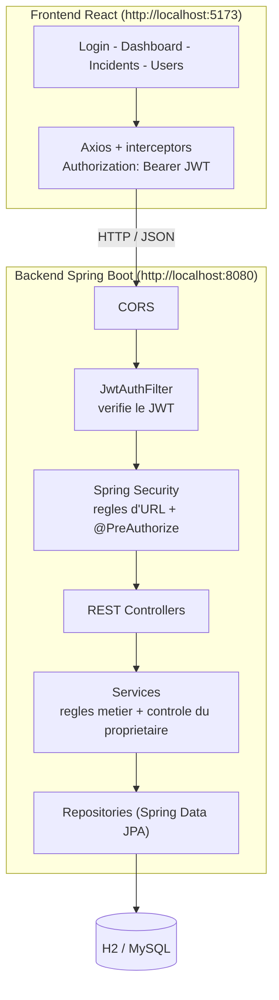
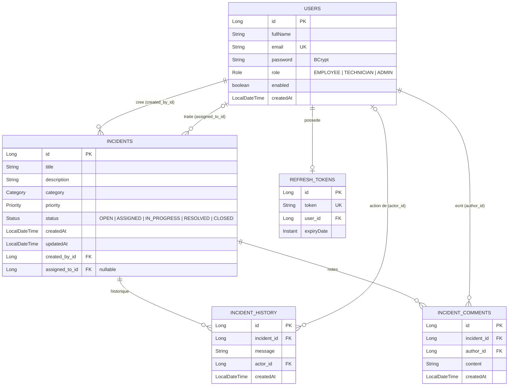
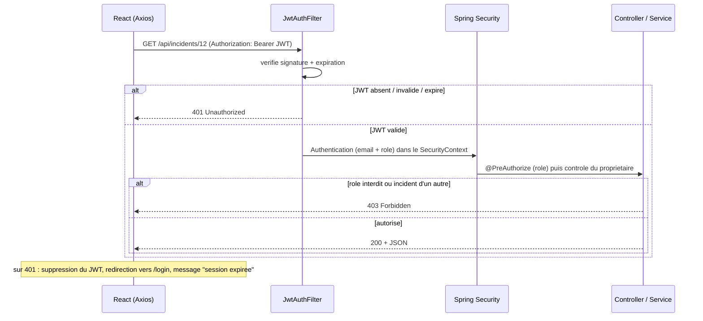

# Diagrammes

Les diagrammes ci-dessous sont en **Mermaid** : ils s'affichent directement sur GitHub / GitLab / VS Code
(extension "Markdown Preview Mermaid Support"). Pour les inserer dans le rapport PDF, collez le code sur
<https://mermaid.live> puis exportez en PNG ou SVG.

## 1. Architecture generale

## 2. Diagramme des entites

## 3. Sequence d'une requete protegee

